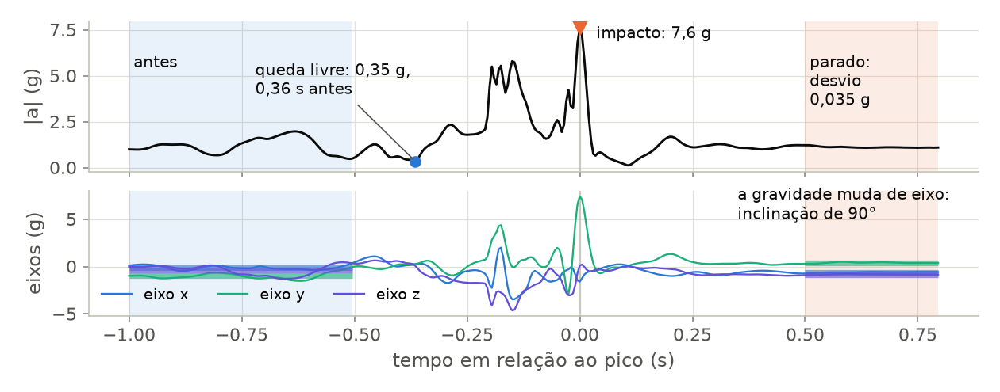
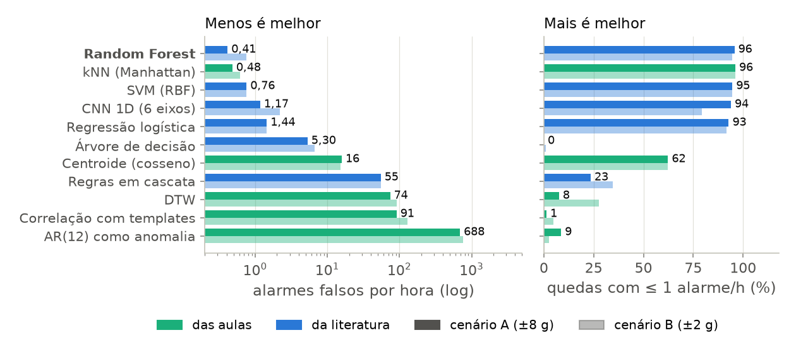
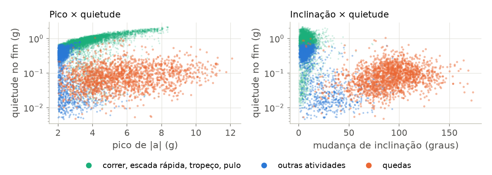
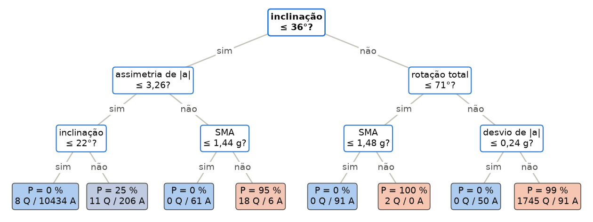
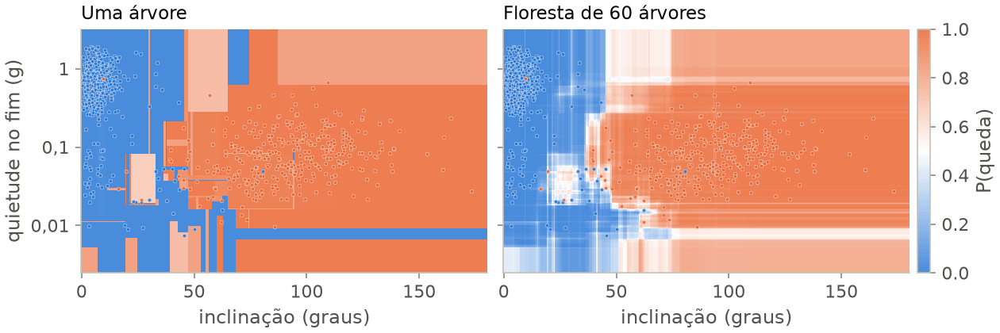
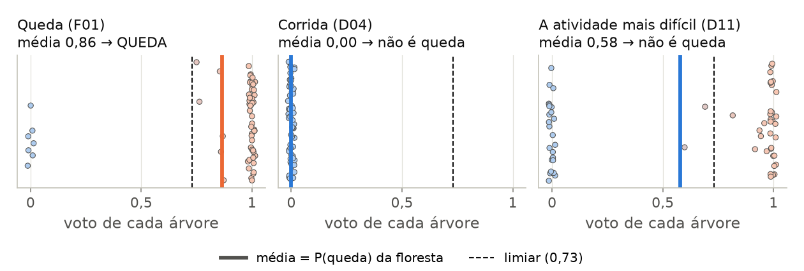
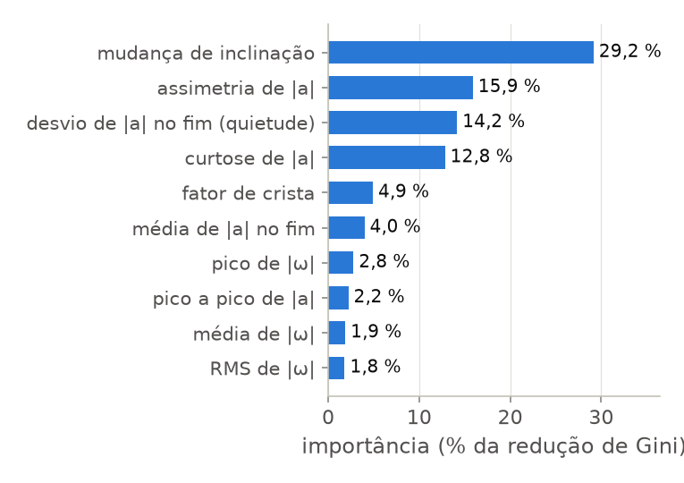

# Como funciona cada modelo testado (Q1)

Guia de estudo para a apresentação. Explica o que cada método faz, como ele foi montado no nosso código
(`modelo/queda/modelos.py` e `cnn.py`), o resultado dele e por que deu esse resultado. A ordem segue a tabela
do slide 9. O [roteiro](roteiro-apresentacao.md) diz o que falar em cada slide; este arquivo é o que está
por trás.

Os números são da SisFall no **cenário A** (±8 g, a faixa do vestível), com validação cruzada por pessoa, os
mesmos dos slides. Quando o cenário B (±2 g) ou os nossos 18 ensaios mudam a história, isso aparece no texto.

---

## Parte 1. O que todos têm em comum

### O problema

Chega uma janela de sinal do acelerômetro e do giroscópio. O modelo tem de responder **queda** ou **não
queda**. Todos os métodos fazem a mesma coisa no fim: dão um **escore** para a janela (quanto maior, mais
parecido com queda) e um **limiar** decide.

### O caminho até o modelo (pipeline)

1. **Filtro passa-baixa de 20 Hz** nos 6 eixos: tira ruído e vibração e mantém o movimento do corpo.
2. **Gatilho:** só acorda o modelo quando \|a\| passa de 2,0 g num pico. Deixa passar 99,2 % das quedas, mas
   também dispara ~750–860 vezes por hora em atividades normais (passos de corrida, sentar com força).
   **Quem decide é o modelo, não o gatilho.**
3. **Janela** de 1,0 s antes até 0,8 s depois do pico: 360 amostras a 200 Hz.
   - Antes do pico fica a queda livre (o corpo "sem peso", \|a\| perto de 0).
   - Depois fica a reação: numa queda o corpo para e fica deitado; numa corrida, continua se mexendo e em pé.

### Duas formas de olhar a janela

Os métodos se dividem em dois grupos, e essa é a lição principal da comparação:

| Olham o **sinal** (a forma da onda) | Olham um **vetor de atributos** (números calculados da janela) |
|---|---|
| correlação com templates, DTW, AR, CNN | regras, centroide, kNN, regressão logística, árvore, SVM, Random Forest |
| usam \|a\| reduzido a 50 Hz (90 amostras); a CNN de 6 eixos usa os eixos | usam 34 atributos: 23 no tempo, 6 de frequência (FFT) e 5 do AR(4) |

**Os 23 atributos no tempo** (os que foram para o vestível), em grupos:
- **Estatísticas de \|a\|:** média, RMS, desvio, mínimo, máximo, fator de crista (máximo/RMS), curtose,
  assimetria, cruzamentos por zero, pico a pico, SMA (soma dos módulos dos eixos).
- **Queda livre:** o menor \|a\| antes do pico e quanto tempo antes do impacto ele aconteceu.
- **Depois do impacto:** desvio e média de \|a\| nos últimos 0,3 s (o corpo parado tem desvio quase zero e
  média ~1 g).
- **Inclinação:** o ângulo entre a gravidade no começo da janela e no fim. Em pé → deitado dá ~90°.
- **Correlação entre os eixos** do acelerômetro (xy, xz, yz).
- **Giroscópio:** média, RMS e máximo de \|ω\|, e a rotação total em graus.

Eles usam módulos e ângulos, que não dependem de como a placa está presa. Isso importa porque a SisFall e os
nossos ensaios têm a placa em orientações diferentes.

### Como medimos

- **Validação cruzada por pessoa (5 dobras):** as 38 pessoas são divididas em 5 grupos. O modelo treina com 4
  grupos e é testado no que ficou de fora, e isso se repete 5 vezes. Ninguém aparece no treino e no teste ao
  mesmo tempo; se aparecesse, o modelo "reconheceria a pessoa" e o resultado ficaria inflado.
- **Ponto de operação:** o limiar é posto de modo que 95 % das janelas de queda fiquem acima dele. Nesse
  ponto contamos os **alarmes falsos por hora** de atividade (são 14,5 h de atividades na SisFall).
  Por isso quase todos os métodos aparecem com 94,3 % das quedas: 99,2 % passam pelo gatilho × 95 %.
- **Quedas com ≤ 1 alarme/h:** a outra medida. É quantas quedas o modelo pega se só tolerarmos 1 alarme
  falso por hora de atividade.
- **AUC:** a área sob a curva ROC (1 = perfeito, 0,5 = chute). Quase todos os bons métodos ficam em 0,99 e não
  se separam por ela: a diferença está na cauda, nos poucos alarmes falsos que sobram. Por isso usamos
  alarmes/h.

### Resultado geral

Quem compara formas de onda (correlação, DTW, AR) fica em dezenas a centenas de alarmes por hora. Os
classificadores treinados sobre os atributos (kNN, logística, SVM, Random Forest) ficam abaixo de 2 por hora.
No meio ficam o centroide e as regras: usam atributos, mas com uma fronteira simples demais ou fixa à mão. O
motivo está na figura abaixo: **o que separa a queda é a postura e a quietude depois
do impacto e a queda livre antes**, e os atributos medem isso diretamente. A forma de \|a\| em volta do pico é
parecida numa queda, numa corrida e num sentar com força.

---

## Parte 2. Os métodos das aulas

### 1. Correlação com templates (filtro casado)

**Ideia:** guardar alguns exemplos típicos de queda e de atividade ("templates") e ver com qual deles a janela
nova se parece mais.

**Como foi montado:**
- **Templates:** 8 de queda e 8 de atividade, escolhidos por k-means sobre o \|a\| a 50 Hz. De cada grupo fica
  o exemplo real mais perto do centro (um "medoide"), para o template ser um sinal de verdade e não uma média
  borrada.
- **Correlação:** a janela é deslizada até ±0,2 s em relação a cada template, e fica a maior correlação.
- **Escore:** a melhor semelhança com uma queda menos a melhor semelhança com uma atividade.
- **Duas versões:**
  - **normalizada** (coeficiente de Pearson): só a forma importa, a amplitude não;
  - **não normalizada:** o produto direto, em que janelas fortes pontuam alto.

**Resultado:**
- normalizada: 90,9 alarmes/h e 1,3 % das quedas com ≤ 1 alarme/h;
- não normalizada: 139,2 alarmes/h e 22,0 %.

**Por que foi mal:**
- Só olha o \|a\|. Não vê a postura (a gravidade mudando de eixo), que é o que mais separa queda de atividade.
- A forma do pico é parecida em quedas e em movimentos bruscos.
- A versão normalizada joga fora a amplitude, que também é informação. A não normalizada confunde "forte" com
  "queda".
- 8 templates não cobrem 15 tipos de queda e 19 de atividade.

**Nos nossos ensaios:** pegou as 10 quedas, mas com 12 alarmes falsos, em 6 das 8 atividades.

### 2. DTW (Dynamic Time Warping)

**Ideia:** a mesma comparação com templates, mas aceitando que o movimento seja mais rápido ou mais lento.
O DTW "estica e encolhe" o tempo para alinhar os dois sinais da melhor forma e mede a distância depois do
alinhamento.

**Como foi montado:**
- os mesmos templates da correlação;
- custo \|r[i] − x[j]\| ponto a ponto, por programação dinâmica;
- **banda de Sakoe–Chiba** de 9 amostras (0,18 s): o alinhamento não pode se afastar demais da diagonal, senão
  qualquer sinal "vira" qualquer outro;
- escore: a distância à atividade mais parecida menos a distância à queda mais parecida.

**Resultado:** 74,0 alarmes/h e 7,6 % das quedas com ≤ 1 alarme/h. Melhor que a correlação, porque tolera
variações de velocidade, mas com o mesmo limite de fundo: só a forma de \|a\|.

**Nos nossos ensaios:** 10 de 10 quedas, mas 8 alarmes falsos, em 6 das 8 atividades.

### 3. AR(12) como detector de anomalia

**Ideia:** um modelo autorregressivo prevê a próxima amostra a partir das anteriores:
x̂[n] = a₁·x[n−1] + … + a₁₂·x[n−12]. Se ele for treinado **só com atividades normais**, deve errar muito
numa queda, porque ela é "estranha". O erro de predição vira o escore.

**Como foi montado:**
- **Ordem 12, escolhida pelo BIC:** a variância do resíduo cai de 0,27 g² com p = 1 para 0,11 g² com p = 12.
- **Coeficientes:** ajustados por mínimos quadrados, â = (AᵀA)⁻¹Aᵀb, em todas as janelas de atividade do treino.
- **Escore:** o maior \|x[n] − x̂[n]\| dentro da janela.
- **Variante ARX(12):** usa também \|ω\| como entrada externa. Deu praticamente o mesmo.

**Resultado:** 688 alarmes/h, 8,6 % das quedas com ≤ 1 alarme/h e AUC 0,79. É o pior de todos.

**Por que foi mal:** "anomalia" não é o mesmo que "queda". Qualquer movimento brusco (pular, sentar rápido,
tropeçar) também é imprevisível e gera erro grande. O AR mede o quanto o sinal é previsível, e isso não separa
as classes.

**Onde o AR entrou mesmo assim:**
- Os coeficientes de um AR(4) e o desvio do resíduo viraram 5 atributos do vetor.
- Mas, sozinhos, levam o Random Forest a só 5,2 % das quedas com ≤ 1 alarme/h. Por isso não foram para o
  vestível.

### 4. Centroide mais próximo (distância de cosseno)

**Ideia:** calcular o "vetor médio" de atributos das quedas e o das atividades. A janela nova é da classe
cujo centro está mais perto.

**Como foi montado:**
- os 34 atributos padronizados (média 0, desvio 1), senão os de escala grande dominariam a distância;
- um centroide por classe;
- escore = distância ao centro das atividades − distância ao centro das quedas;
- três distâncias testadas: euclidiana (23,1 alarmes/h), Manhattan (28,5/h) e cosseno (15,8/h, a melhor).
  O cosseno compara a **direção** do vetor e ignora o tamanho.

**Resultado:** 15,8 alarmes/h e 62,3 % das quedas com ≤ 1 alarme/h.

**Por que é limitado:** "atividade" é uma classe muito variada (andar, sentar, correr, subir escada). Um único
ponto médio não representa todas, e a fronteira entre dois centroides é uma reta (um plano). Já usa os
atributos certos, por isso é bem melhor que os métodos de forma de onda, mas é simples demais.

**Nos nossos ensaios:** 8 de 10 quedas, 4 alarmes falsos.

### 5. kNN (k vizinhos mais próximos, distância de Manhattan)

**Ideia:** não aprende nada; guarda todas as janelas de treino. Para uma janela nova, acha as 7 mais
parecidas e faz uma votação.

**Como foi montado:**
- atributos padronizados;
- k = 7, com voto ponderado pela distância (vizinho mais perto pesa mais);
- três distâncias: Manhattan (a melhor), euclidiana e cosseno;
- escore = fração ponderada dos vizinhos que são queda.

**Resultado:** 0,48 alarme/h e **96,1 %** das quedas com ≤ 1 alarme/h, a melhor detecção de todas.

**Por que ficou de fora do vestível:** o modelo é o próprio treino.
- Guarda as ~11 mil janelas de treino × 34 atributos: 1,6 MB, seis vezes o Random Forest da comparação, e
  cresce a cada dado novo.
- Cada decisão compara a janela com todas elas: ~820 mil operações, contra ~45 mil dos outros (que gastam quase
  tudo calculando os atributos).
- O ganho sobre o Random Forest é pequeno: 96,1 % contra 95,7 % das quedas.

Ele serve de prova de que os atributos separam bem as classes: com eles, até o método mais simples de
vizinhança vai bem.

**Nos nossos ensaios:** 8 de 10 quedas, 1 alarme falso.

---

## Parte 3. Os métodos da literatura

### 6. Regras em cascata

**Ideia:** a regra clássica dos artigos de detecção de queda, escrita à mão:

> houve queda livre antes do impacto (\|a\| < 0,6 g) **E** depois dele o corpo ficou parado (desvio < 0,15 g)
> **OU** a inclinação mudou (> 40°).

**Como foi montado:** o escore conta quantas condições foram atendidas (a queda livre vale 2), para dar uma
curva ROC.

**Resultado:** 54,9 alarmes/h e 23,5 % das quedas com ≤ 1 alarme/h.

**Por que foi mal:** os limiares são fixos e escolhidos por gente, não pelos dados. Sentar rápido numa cadeira
baixa, por exemplo, também tem um "quase queda livre" e muda a inclinação. A ideia está certa (usa queda livre,
quietude e postura, os mesmos atributos que mais pesam no Random Forest), mas as fronteiras são rígidas demais.

**Nos nossos ensaios:** 8 de 10 quedas, 5 alarmes falsos.

### 7. Regressão logística

**Ideia:** soma ponderada dos atributos, passada por uma sigmoide para virar probabilidade:

P(queda) = 1 / (1 + e^−(b + w₁·x₁ + … + wₙ·xₙ))

Cada peso diz quanto aquele atributo empurra para "queda" ou para "atividade". O treino acha os pesos que
melhor separam as classes.

**Como foi montado:**
- atributos padronizados;
- classes balanceadas: as quedas são poucas e pesam mais no treino.

**Como os pesos são aprendidos** (aprendizado supervisionado, com as janelas rotuladas):
1. Para cada janela de treino, o modelo calcula a P(queda) com os pesos atuais.
2. Compara com o rótulo pela **entropia cruzada**: −log(P) se era queda, −log(1 − P) se era atividade. Errar
   com confiança custa muito.
3. Ajusta os pesos na direção que reduz esse erro (pelo gradiente, com o algoritmo L-BFGS) e repete até parar
   de melhorar.
4. Uma penalidade para pesos grandes (regularização L2) evita decorar o treino.

O problema tem uma só melhor solução: treinar de novo com os mesmos dados dá os mesmos pesos. O que **não** é
aprendido nesse ajuste:
- os atributos (escolhidos por nós);
- a média e o desvio da padronização (só calculados no treino);
- o limiar de 0,96, escolhido depois, na validação.

Maiores pesos no vestível, em desvios padrão de cada atributo:

| Atributo | Peso |
|---|---|
| inclinação | +3,14 |
| fator de crista | +2,85 |
| assimetria de \|a\| | +2,41 |
| curtose de \|a\| | −3,36 |
| intercepto | −4,77 |

O intercepto negativo faz o modelo partir de "não queda". Cuidado ao ler um peso sozinho: atributos parecidos
(curtose, crista e assimetria descrevem o formato do pico) dividem e compensam os pesos entre si.

**Resultado:**
- na comparação (34 atributos): 1,44 alarme/h e 92,8 % das quedas com ≤ 1 alarme/h. Ocupa 412 bytes;
- na configuração do vestível (23 atributos): 0,62 alarme/h e 94,9 %, com 0,3 kB.

**Pontos fortes:** é o mais simples de todos e o mais fácil de auditar (23 pesos). Ficou no vestível como
**opção no `menuconfig`**.

**Limite:** a fronteira entre as classes é um plano (uma "reta" em 23 dimensões). Não consegue regras do tipo
"isto só importa se aquilo também acontecer".

**Nos nossos ensaios:** 7 de 10 quedas, 0 alarmes falsos.

### 8. Árvore de decisão (uma só)

**Ideia:** uma sequência de perguntas sim/não sobre os atributos ("a inclinação é ≤ 36°?"). Cada resposta
leva a outra pergunta, até uma **folha**, que diz a probabilidade de queda.

**Como foi montado:** profundidade máxima 6 (até 64 folhas) e classes balanceadas. O aprendizado das
perguntas está explicado no Random Forest, abaixo, porque é o mesmo.

**Resultado:** 5,30 alarmes/h e **0,0 %** das quedas com ≤ 1 alarme/h.

**Por que o 0,0 %:**
- **Escores grosseiros:** a árvore só dá um punhado de valores diferentes, um por folha. Muitas janelas de
  atividade caem na mesma folha "quase certeza de queda" que as quedas. Para ficar em ≤ 1 alarme/h, o limiar
  teria de passar acima dessa folha, e aí nenhuma queda passa junto.
- **Decora o treino:** uma árvore sozinha se ajusta demais aos detalhes das pessoas do treino e erra em
  pessoas novas.

É a peça que o Random Forest usa, e mostra por que ele precisa de muitas árvores.

### 9. SVM com kernel RBF

**Ideia:** achar a fronteira que separa as classes com a **maior margem** possível (a maior "faixa vazia"
entre elas). Com o kernel RBF a fronteira pode ser curva.

**Como funciona o RBF:**
- O SVM guarda alguns exemplos de treino, os **vetores de suporte**: os que ficam perto da fronteira e a
  definem.
- Para uma janela nova, mede a semelhança com cada vetor de suporte: exp(−γ·‖x − v‖²), que vale 1 quando são
  iguais e cai para 0 quando são distantes.
- O escore é uma soma ponderada dessas semelhanças. É parecido com o kNN, mas aprende quais exemplos guardar e
  com que peso.

**Como foi montado:**
- atributos padronizados (obrigatório: o RBF usa distância);
- C = 3, que equilibra uma margem larga contra errar no treino;
- γ automático ("scale");
- classes balanceadas;
- na comparação, treinou com 6 000 janelas de atividade sorteadas, para ficar rápido.

**Resultado:**
- **Comparação:** 0,76 alarme/h e 94,6 % das quedas com ≤ 1 alarme/h, com 45 kB.
- **Configuração do vestível** (`11_svm_vestivel.py`, rodado em 2026-11-13):
  - 0,69 alarme/h e 96,2 % das quedas com ≤ 1 alarme/h, treinando com todas as janelas;
  - 34 kB na flash (348 vetores de suporte);
  - mas ~24 mil operações e 348 exponenciais por janela, contra ≤ 600 comparações do Random Forest.

**SVM × Random Forest, o que dizer se perguntarem:**
- **Na SisFall eles empatam.** Sorteando as pessoas de novo 2 000 vezes (bootstrap), a diferença de alarmes/h
  varia de −0,42 a +0,80, e a de quedas de −4,3 a +2,9 pontos. Os dois intervalos passam pelo zero.
- **A vantagem do SVM nos nossos ensaios** (8 contra 7 de 10 quedas) é **uma** queda de joelhos, de uma
  pessoa só.
- **Tamanho e processamento não decidem:**
  - o SVM é menor na flash, mas faz bem mais conta por janela;
  - as duas coisas cabem com folga no ESP32-S3, e o modelo só roda quando o gatilho dispara.
- **O Random Forest é mais prático:**
  - não precisa padronizar os atributos nem reajustar C e γ quando retreinarmos com os dados do pulso;
  - a probabilidade sai direto dos votos;
  - mostra quais atributos pesam.
- **O SVM continua candidato** na comparação que vamos refazer com os dados do pulso.

**Nos nossos ensaios:** 8 de 10 quedas, 0 alarmes falsos.

### 10. CNN 1D (rede neural convolucional)

**Ideia:**
- A rede recebe o sinal cru da janela e aprende sozinha o que olhar, sem atributos escolhidos por nós.
- Cada camada de convolução é um **banco de filtros FIR que a rede aprende**: em vez de receber templates
  prontos, como no filtro casado, ela aprende os próprios.

**Como foi montada:**
- **Entrada:** os 6 eixos reduzidos a 50 Hz (90 amostras). A outra versão recebe só \|a\| e \|ω\|.
- **Camadas:** 3 convoluções (16, 32 e 32 filtros, de tamanhos 7, 5 e 3), com ReLU e redução pela metade entre
  elas; depois uma média no tempo e uma saída.
- **Tamanho:** ~6 mil parâmetros, 26 kB, pequena de propósito para caber no ESP32.
- **Treino:** 15 épocas, com peso maior para as quedas.

**Resultado:**
- **6 eixos, cenário A:** 1,17 alarme/h e 93,9 % das quedas com ≤ 1 alarme/h. Bom, mas não melhor que os
  atributos.
- **6 eixos, cenário B (±2 g):** cai para 79,4 %. Com o sensor saturando, a forma do sinal muda e a rede, que
  aprendeu a forma, sofre mais que os atributos.
- **Só \|a\| e \|ω\|:** 59,1 %. Sem os eixos, ela não vê a gravidade mudando de eixo (a postura).

**Por que ficou de fora:**
- Com os eixos, ela depende de a placa estar sempre na mesma orientação, e na pulseira não está.
- Sem os eixos, ela perde o que mais importa.
- Custo: ~240 mil operações por janela.

**Nos nossos ensaios** (versão só com os módulos): 9 de 10 quedas, mas 12 alarmes falsos.

---

## Parte 4. Random Forest, o escolhido

Esta é a parte que precisa ser explicada a fundo (slides 12 a 17). A impureza de Gini, no passo 1, não está
nos slides: fica aqui para o caso de alguém perguntar como a árvore escolhe as perguntas.

### Passo 1: uma árvore aprende fazendo perguntas

- **Cada nó** pergunta "atributo ≤ limiar?". O treino escolhe, entre todos os atributos e limiares possíveis,
  a pergunta que melhor separa quedas de atividades.
- **"Melhor" é medido pela impureza de Gini:** G = 1 − p² − (1 − p)², onde p é a fração de quedas no grupo.
  - G = 0 quando o grupo é puro (só quedas ou só atividades);
  - G = 0,5 quando está meio a meio.
  - A pergunta escolhida é a que mais reduz o Gini.
- **No nosso caso, a primeira pergunta é "inclinação ≤ 36,1°?"**, e o Gini cai de 0,50 para 0,04 dos dois
  lados:
  - **sim (pouca inclinação):** 10 707 atividades e só 37 quedas;
  - **não (inclinou muito):** 1 747 quedas e 232 atividades.

  Só essa pergunta já separa quase tudo: quem cai termina deitado.
- **Desbalanceamento:** são 1 784 janelas de queda contra 10 939 de atividade. Sem correção, a árvore aprenderia
  a dizer sempre "atividade". Por isso cada queda pesa 3,57 e cada atividade 0,58 no treino.
- **A árvore para na profundidade 10** (no vestível). A **folha** guarda a fração de quedas de treino que
  chegaram nela: essa é a P(queda) daquela árvore.

### Passo 2: muitas árvores diferentes (a floresta)

Uma árvore só decora o treino (5,3 alarmes/h, como visto acima). O Random Forest treina muitas árvores
**diferentes de propósito**:
- **Bagging:** cada árvore treina com um sorteio com reposição das janelas, então vê ~63 % delas, algumas
  repetidas.
- **Atributos sorteados:** em cada nó, a árvore só pode escolher entre 4 atributos sorteados (√23 ≈ 4), e não
  entre os 23. Assim nem toda árvore começa pela inclinação, e elas aprendem caminhos diferentes.
- **A decisão é a média dos votos:** P(queda) = a média das P(queda) das folhas a que a janela chega em cada
  árvore.

Cada árvore erra, mas **em lugares diferentes**, e a média cancela boa parte dos erros. Uma árvore sozinha dá
5,3 alarmes/h; a floresta, 0,4/h.

Na figura: a árvore sozinha divide o espaço em blocos e ilhas (decorou o treino). A floresta faz uma transição
graduada, com uma probabilidade que sobe aos poucos.

### Passo 3: os votos na prática

- **Numa queda,** quase todas as árvores votam queda: média 0,86.
- **Numa corrida,** nenhuma: 0,00.
- **Na atividade mais difícil** (D11, tentar levantar da cadeira e desabar sentado), as árvores discordam: 0,58,
  abaixo do limiar de 0,73. Por isso não vira alarme.

O limiar de 0,73 é o que mantém 95 % das quedas acima dele (o ponto de operação explicado na Parte 1).

### Passo 4: o que a floresta olha

- **O que mais pesa:** a mudança de inclinação (a postura depois) e a assimetria de \|a\| (a forma do impacto).
  O pico do impacto quase não pesa, porque o gatilho já filtrou por ele e correr também tem pico alto.
- **Grupos de atributos sozinhos:** só os do tempo dão 95,4 % das quedas com ≤ 1 alarme/h; só a FFT, 7,8 %; só
  o AR, 5,2 %. Juntos com os do tempo, os de FFT ainda tiram alguns alarmes falsos; o vestível ficou só com os
  do tempo por simplicidade (ver a pergunta sobre a FFT na Parte 5).

### Os números

| | Comparação (slide 17) | Vestível (slide 20) |
|---|---|---|
| Árvores × profundidade | 150 × 12 | 60 × 10 |
| Atributos | 34 (tempo, FFT, AR) | 23 (só tempo) |
| Gatilho | por picos (olha o futuro, só no PC) | causal (amostra a amostra) |
| Alarmes falsos/h | 0,41 | 0,55 |
| Quedas com ≤ 1 alarme/h | 95,7 % | 95,1 % |
| Flash | 252 kB | 106 kB |

No cenário B (±2 g), o da comparação dá 0,76 alarme/h e 94,4 %: é o que menos perde com a saturação.
**Nos nossos ensaios:** 7 de 10 quedas e nenhum alarme falso. Pegou as 7 de frente e de costas e perdeu as 3
de joelhos, que são mais lentas e têm ensaios curtos (~1 s depois do impacto).

### Por que ele foi o escolhido

1. **Menos alarmes falsos** na faixa do vestível, com ~95–96 % das quedas.
2. **Perde pouco com a saturação** em ±2 g, que pode voltar no pulso (impactos acima de 8 g).
3. **Não precisa normalizar:** cada pergunta é um limiar em g, graus ou segundos. Isso facilita o retreino.
4. **Cabe no ESP32:** no máximo 600 comparações por janela. O custo maior é calcular os atributos.
5. **É explicável:** dá para mostrar quais atributos pesam e seguir o caminho de uma janela pela árvore.

Os que chegaram perto e por que não:
- **kNN:** detecta mais, mas guarda o treino inteiro (1,6 MB).
- **SVM:** empata, mas não traz ganho que justifique outro classificador em C.
- **Logística:** muito simples, mas tem o triplo de alarmes na comparação. Ficou como opção.
- **CNN:** cai muito em ±2 g e depende da orientação da placa.

---

## Parte 5. Perguntas prováveis e respostas curtas

**Por que não usar só o limiar (o pico de \|a\|)?**
Correr, pular e sentar com força passam de 2 g centenas de vezes por hora. O limiar pega quase todas as
quedas, mas sozinho daria dezenas de alarmes falsos por hora. Por isso ele virou só o gatilho que acorda o
modelo.

**Por que os resultados quase todos têm 94,3 % das quedas?**
Porque o limiar de cada modelo é posto para pegar 95 % das janelas de queda, e o gatilho deixa passar 99,2 %
delas: 99,2 % × 95 % = 94,3 %. Fixando a detecção, a comparação justa é quantos alarmes falsos cada um dá.

**O kNN detectou mais. Por que não ele?**
Porque o modelo dele é o treino inteiro (1,6 MB) e cada decisão compara com ~11 mil janelas, quase 20 vezes a
conta dos outros. O ganho é pequeno (96,1 % contra 95,7 %), e o Random Forest chega perto com uma fração do
custo.

**E o SVM, que foi melhor nos ensaios de vocês?**
Ver o item 9. Rodamos o SVM na mesma configuração do vestível: na SisFall ele empata com o Random Forest, e a
vantagem nos nossos ensaios é uma queda de joelhos em 10.

**Por que a CNN, que é mais moderna, não ganhou?**
Com poucos dados (~1 800 quedas) e um sinal simples, atributos bem escolhidos já carregam a informação. A CNN
precisa dos eixos para ver a postura, e aí depende da orientação da placa. Além disso, sofre mais quando o
sensor satura.

**Vocês viram FFT em aula. Por que ela não está no vestível?**
Testamos: são 6 atributos de FFT de \|a\| (a fração de energia em 0,5–3, 3–6, 6–12 e 12–25 Hz, a frequência
dominante e o centroide espectral).
- **Sozinhos, quase não servem** (7,8 % das quedas com ≤ 1 alarme/h). A FFT diz quais frequências existem, mas
  não **quando** elas acontecem, e a queda é uma sequência: queda livre, depois impacto, depois o corpo parado.
  Além disso, ela é calculada sem a média, o que tira a gravidade e, com ela, a postura. E queda e movimento
  brusco são os dois um "impacto", com energia espalhada pelas mesmas faixas.
- **Junto com os do tempo, ajudam um pouco:** os alarmes falsos caem de 0,76 para 0,48 por hora, com as mesmas
  ~95,5 % das quedas.
- **Ficaram fora do vestível por simplicidade, não por custo:**
  - a primeira versão no C só tem os 23 atributos no tempo, que já ficam abaixo de 1 alarme/h;
  - a FFT de 512 pontos custa pouco no ESP32-S3 (o ESP-DSP tem), mas é mais código a manter idêntico ao Python;
  - as faixas foram medidas na cintura, e no pulso o balanço do braço muda o espectro.

  Voltam se os dados do pulso pedirem.

**Por que validar por pessoa?**
Porque as janelas da mesma pessoa se parecem. Com a pessoa no treino e no teste, o modelo "reconheceria a
pessoa" e os números ficariam melhores do que seriam com um idoso novo.

**Os números valem para a pulseira?**
Ainda não. Todos os dados são da cintura. É a principal limitação: o próximo passo é coletar no pulso, com
várias pessoas, e retreinar.

**Por que 0,41 alarme/h num slide e 0,55 no outro?**
São duas florestas. A da comparação tem 150 árvores e usa os 34 atributos (com FFT e AR). A do vestível tem 60
árvores e usa os 23 atributos no tempo, que o C calcula sem FFT.

**O que a P(queda) que vai no alerta significa?**
É a fração média dos votos das árvores. Não é uma probabilidade calibrada, mas ordena bem: quanto mais perto de
1, mais árvores concordam que foi queda.

---

## Glossário rápido

| Termo | O que é |
|---|---|
| Janela | o trecho de 1,8 s em volta do pico que o modelo analisa |
| Atributo | um número calculado da janela (ex.: a inclinação, o menor \|a\| antes do impacto) |
| Escore | a nota que o modelo dá à janela; maior = mais parecido com queda |
| Limiar | o valor do escore a partir do qual vira alarme |
| Alarmes falsos/h | quantas vezes por hora de atividade normal o modelo diria "queda" sem ter havido |
| Quedas com ≤ 1 alarme/h | quantas quedas ele pega se tolerarmos no máximo 1 alarme falso por hora |
| AUC | área sob a curva ROC; 1 é perfeito, 0,5 é chute |
| Validação cruzada por pessoa | treinar sem uma pessoa e testar nela, para todas |
| Saturação | o sensor tem um teto (±2 g ou ±8 g); acima disso o valor fica cortado |
| Cenário A / B | a SisFall cortada em ±8 g (o vestível) / em ±2 g (os nossos ensaios) |
| Bagging | treinar cada árvore com um sorteio diferente dos dados |
| Gini | medida de mistura de um grupo: 0 = puro, 0,5 = meio a meio |
| Vetor de suporte | exemplo de treino que o SVM guarda porque fica perto da fronteira |
| Bootstrap | refazer a conta sorteando as pessoas de novo, para ver quanto o resultado varia |
