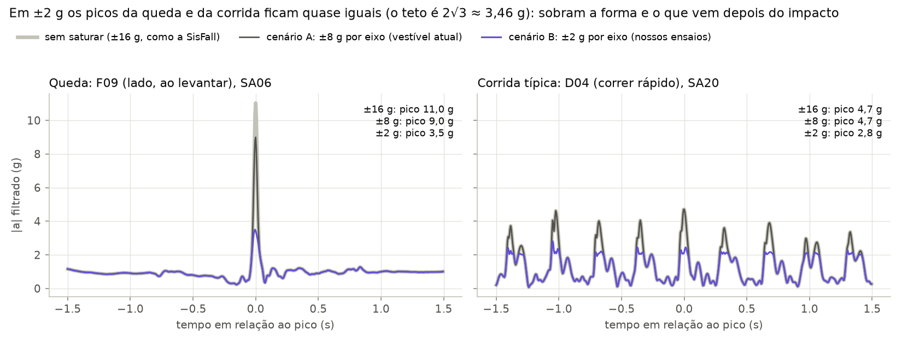
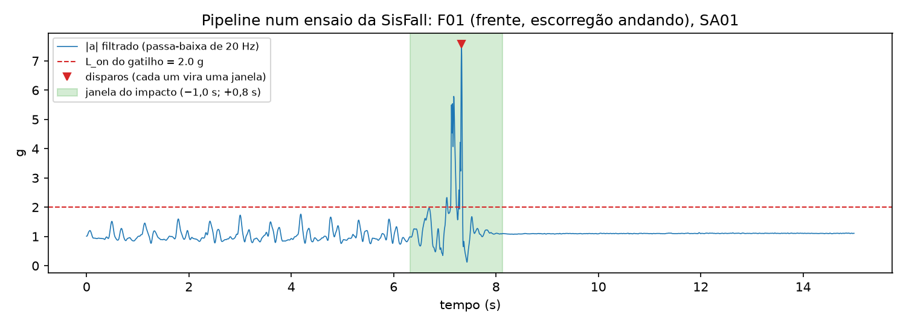
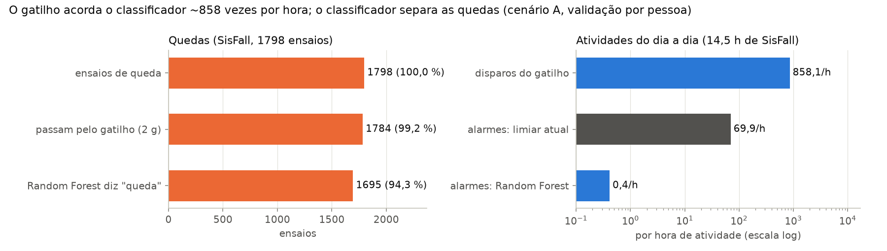
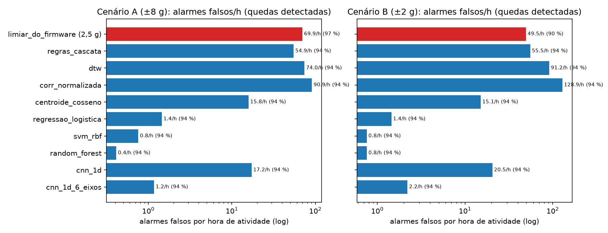
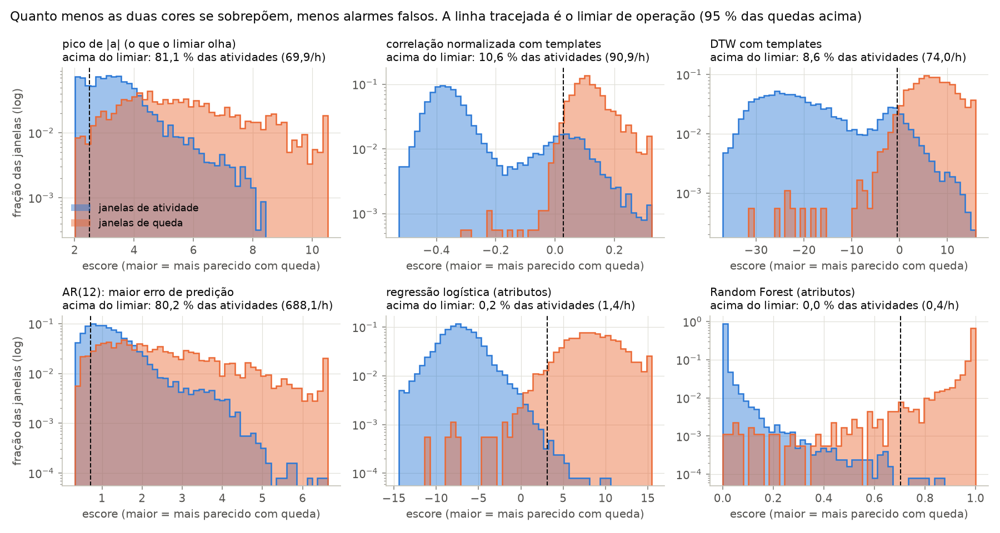
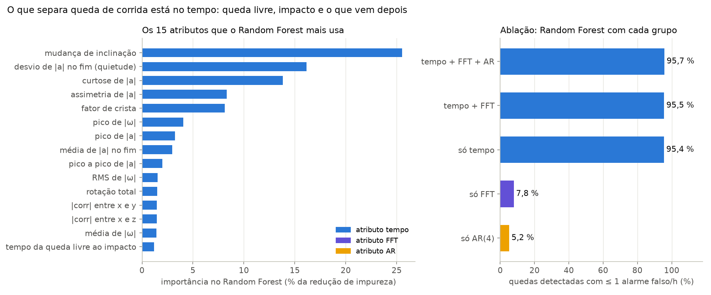
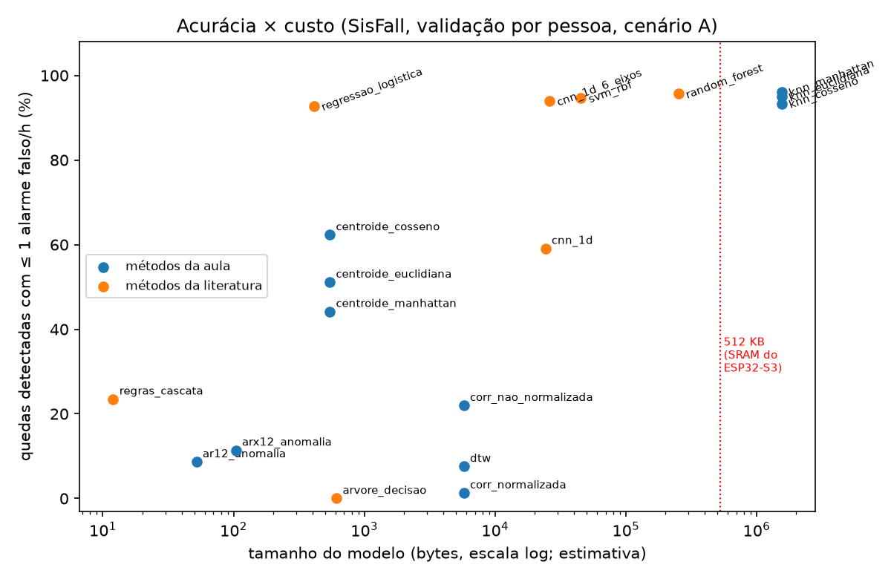
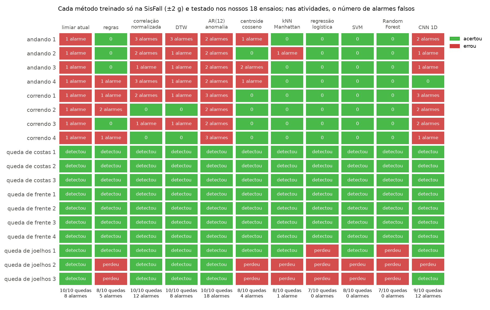
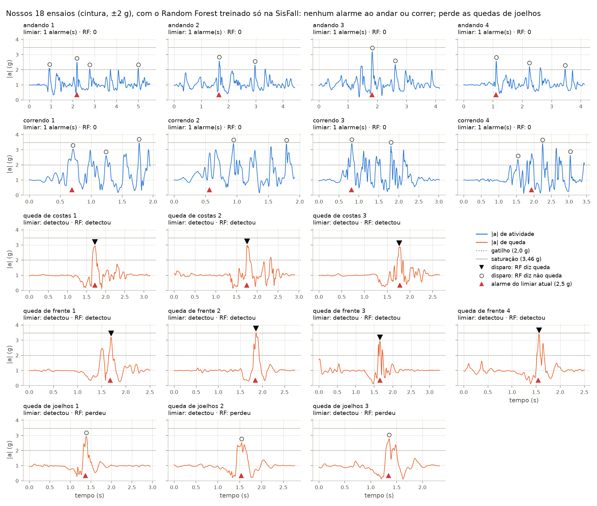
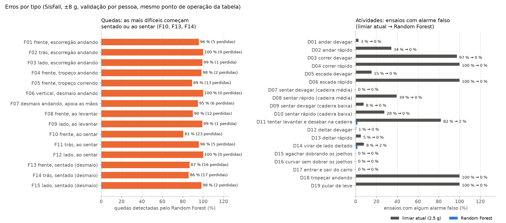

# Projeto 3, Q1: modelos de detecção de queda (rascunho do relatório)

> Rascunho gerado a partir do código e das tabelas em [`modelo/`](../../../../modelo/). Os números vêm de
> [`modelo/resultados/resumo.md`](../../../../modelo/resultados/resumo.md); se os experimentos forem refeitos,
> confira-os de novo. As figuras estão em `modelo/resultados/`.
>
> A versão para entrega é a em LaTeX: [`latex/main.tex`](latex/main.tex), com o PDF em
> [`latex/main.pdf`](latex/main.pdf). Ao mudar o texto, mude lá.

## 1. Objetivo

Desenvolver e comparar, no PC, modelos que decidem se houve queda a partir do acelerômetro e do giroscópio do
vestível (MPU-6050). O ponto de partida é o detector atual do firmware: um limiar de 2,5 g em |a| com
histerese. Correr, pular ou sentar com força também passam desse limiar.

Os métodos vêm de duas fontes:
- **as aulas:** atributos no tempo, FFT, correlação cruzada com templates, DTW, distâncias entre vetores de
  atributos e modelos autorregressivos;
- **a literatura de detecção de queda:** regras em cascata, regressão logística, árvore, SVM, Random Forest e
  CNN 1D.

A saída é **binária** (queda / não queda). O sistema só precisa disparar o alarme, e um classificador com os
15 tipos de queda dividiria os dados em classes de ~120 exemplos e erraria mais. Os tipos de queda e de
atividade entram na análise dos erros.

## 2. Dados

| Base | Pessoas | Ensaios | Sensor | Faixa | Taxa |
|---|---|---|---|---|---|
| SisFall (Sucerquia et al., 2017) | 38 (23 jovens; 15 idosos, que só fazem atividades, exceto um) | 4505: 2707 atividades (14,5 h) e 1798 quedas | cintura | ADXL345 ±16 g, ITG3200 ±2000 °/s | 200 Hz |
| Nossa | 1 | 18: 8 atividades (andar, correr) e 10 quedas (frente, costas, joelhos) | cintura | MPU-6050 ±2 g, ±250 °/s | ~193 Hz efetivos |

Tratamento dos dados:
- **SisFall:**
  - a pessoa é lida pela pasta, porque há ensaios da SA15 gravados com o nome `D17_SE15`;
  - a base é saturada na faixa de cada cenário (abaixo).
- **Nossos ensaios:**
  - o tempo tem resolução de 10 ms, então foi reconstruído como uniforme e os dados reamostrados para 200 Hz;
  - os ensaios estão saturados em ±2 g, e o |a| máximo fica em 2√3 ≈ 3,46 g;
  - os ensaios são curtos (1,9–5,5 s), com só 0,8–1,6 s depois do impacto.
- **Dois cenários de faixa do sensor**, aplicados à SisFall:
  - **A:** ±8 g / ±500 °/s, a configuração atual do vestível;
  - **B:** ±2 g / ±250 °/s, a dos nossos ensaios, usado para treinar o modelo testado neles.

Em ±2 g, o pico de uma queda e o de uma corrida ficam quase iguais. Sobram a forma do sinal e o que vem depois
do impacto:

## 3. Pipeline

1. **Filtro passa-baixa:** Butterworth de 2ª ordem, 20 Hz, um biquad como o `dsps_biquad_f32` do ESP-DSP.
2. **Gatilho:** picos de |a| acima de L_on, separados por ≥ 0,5 s. Ele não decide a queda, só acorda o
   classificador. Uma primeira versão com histerese e período refratário escondia o impacto atrás de um
   disparo da caminhada anterior. Com o detector de picos, o maior pico (o impacto) sempre dispara.
3. **Janela:** de 1,0 s antes a 0,8 s depois do pico (360 amostras). Cabe no buffer circular de 512 do
   vestível e nos nossos ensaios curtos.
4. **Atributos ou representação** de cada método.
5. **Classificador** → queda / não queda, seguido da espera e da janela de cancelamento que já existem no
   firmware.

**Escolha do L_on** ([fig_gatilho](../../../../modelo/resultados/fig_gatilho.png)):
- o maior limiar que ainda deixa passar ≥ 99 % das quedas da SisFall é **2,0 g**;
- nos dois cenários, ele deixa passar 99,2 % das quedas, com ~860 janelas por hora de atividade;
- nos nossos ensaios, passam 100 % das quedas.

O gatilho deixa passar quase todas as quedas, e o classificador é que separa queda de atividade:

## 4. Métodos

| Método | Ideia | Aula |
|---|---|---|
| Correlação cruzada com templates | Pico de ρ entre a janela (\|a\| a 50 Hz) e 8 medoides de cada classe, atrasos de ±0,2 s. Escore = melhor ρ com quedas − melhor ρ com atividades. **Normalizada** (Pearson: só a forma) e **não normalizada** (média do produto: depende da energia) | Segmentação e atributos |
| DTW | Mesma ideia, com distância DTW e banda de Sakoe–Chiba de ±9 amostras | Segmentação e atributos |
| AR(p) e ARX(p) como anomalia | AR ajustado por mínimos quadrados só nas janelas de atividade. Na queda o modelo erra: escore = maior \|x[n] − x̂[n]\|. O ARX usa \|ω\| como entrada exógena | Modelos Autorregressivos |
| Ordem do AR | AIC e BIC de p = 1 a 12 ([fig_ordem_ar_A](../../../../modelo/resultados/fig_ordem_ar_A.png)) | Modelos Autorregressivos |
| Atributos no tempo | média, RMS, desvio, mín, máx e fator de crista (iguais ao `signal_proc.c` do vestível), curtose, assimetria, ZCR, SMA, queda livre (mín antes do impacto), atividade e inclinação depois, correlação entre eixos, \|ω\| | Segmentação e atributos |
| Atributos em frequência | FFT de 512 pontos de \|a\|: energia nas bandas 0,5–3, 3–6, 6–12 e 12–25 Hz, frequência dominante e centroide | TDF |
| Atributos AR | coeficientes de um AR(4) da janela e desvio do resíduo | Modelos Autorregressivos |
| Distâncias | centroide mais próximo e kNN (k = 7), com distância euclidiana, Manhattan e cosseno, sobre os atributos padronizados | Segmentação e atributos |
| Regras em cascata | queda livre (< 0,6 g) e, depois, corpo parado ou inclinação > 40° | literatura |
| Regressão logística, árvore, SVM, Random Forest | sobre todos os atributos, com classes balanceadas | literatura |
| CNN 1D | 3 camadas de convolução (~6 mil parâmetros). Cada camada é um banco de filtros FIR aprendidos, ou seja, a rede aprende os próprios templates. Entrada só com os módulos (\|a\|, \|ω\|) ou com os 6 eixos | literatura |

## 5. Avaliação

- **Validação cruzada por pessoa** (5 dobras, `StratifiedGroupKFold`): a mesma pessoa nunca está no treino e
  no teste. Misturar janelas da mesma pessoa inflaria os resultados.
- **Janelas:** de cada ensaio de queda entra a janela do impacto. De cada atividade entram todas as janelas
  que o gatilho disparou: cada uma classificada como queda é um alarme falso.
- **Métricas:**
  - AUC;
  - no ponto em que 95 % das janelas de impacto ficam acima do limiar: quedas detectadas por ensaio (contando
    as que o gatilho perdeu) e alarmes falsos por hora de atividade;
  - quedas detectadas com no máximo 1 alarme falso por hora;
  - custo estimado no ESP32-S3: operações por janela e bytes do modelo.
- **Linha de base:** o detector atual do firmware (2,5 g / 1,5 g, espera de 30 s), decidindo sozinho.

## 6. Resultados

Cenário A (±8 g), principais métodos (tabela completa em `resumo.md`):

| Método | AUC | Alarmes falsos/h (quedas detectadas) | Quedas com ≤ 1 alarme/h | Modelo |
|---|---|---|---|---|
| Limiar do firmware (2,5 g) | — | 69,9 (97,4 %) | — | 8 B |
| Regras em cascata | 0,977 | 54,9 (94,3 %) | 23,5 % | 12 B |
| Correlação não normalizada | 0,957 | 139,2 (94,3 %) | 22,0 % | 5,8 kB |
| Correlação normalizada | 0,956 | 90,9 (94,3 %) | 1,3 % | 5,8 kB |
| DTW | 0,974 | 74,0 (94,3 %) | 7,6 % | 5,8 kB |
| AR(12) como anomalia | 0,786 | 688,1 (94,3 %) | 8,6 % | 52 B |
| Centroide (cosseno) | 0,996 | 15,8 (94,3 %) | 62,3 % | 544 B |
| kNN (Manhattan) | 0,995 | 0,5 (94,3 %) | 96,1 % | 1,5 MB |
| Regressão logística | 0,997 | 1,4 (94,3 %) | 92,8 % | 412 B |
| SVM (RBF) | 0,998 | 0,8 (94,3 %) | 94,6 % | 45 kB |
| **Random Forest** | **0,999** | **0,4 (94,3 %)** | **95,7 %** | 252 kB |
| CNN 1D, só módulos | 0,994 | 17,2 (94,3 %) | 59,1 % | 24 kB |
| CNN 1D, 6 eixos | 0,998 | 1,2 (94,3 %) | 93,9 % | 26 kB |

Escores de quedas e de atividades em seis métodos. Quanto menos as duas distribuições se sobrepõem, menos
alarmes falsos no mesmo limiar:

**Ablação do Random Forest** (cenário A), quedas detectadas com ≤ 1 alarme/h por grupo de atributos:
- só tempo: 95,4 %;
- só FFT: 7,8 %;
- só AR: 5,2 %;
- tempo + FFT: 95,5 %;
- todos: 95,7 %.

**Cenário B (±2 g):**
- Random Forest: 94,4 % das quedas com ≤ 1 alarme/h;
- regressão logística: 91,7 %;
- a correlação não normalizada cai para AUC 0,843.

**Nossos ensaios** (modelos treinados na SisFall-B):

| Método | Quedas detectadas | Alarmes falsos (ensaios de atividade com alarme, de 8) |
|---|---|---|
| Limiar do firmware | 10/10 | 8 |
| DTW | 10/10 | 8 (6) |
| Correlação normalizada | 10/10 | 12 (6) |
| CNN 1D (módulos) | 9/10 | 12 (7) |
| SVM (RBF) | 8/10 | 0 |
| Regressão logística | 7/10 | 0 |
| Random Forest | 7/10 | 0 |

Resultado de cada método em cada ensaio (nas atividades, o número de alarmes falsos):

Os 18 sinais, com cada disparo do gatilho, a decisão do Random Forest e os alarmes do limiar atual:

## 7. Discussão

- **O limiar sozinho não serve como decisão** ([fig_picos](../../../../modelo/resultados/fig_picos.png)).
  Correr, escada rápida, tropeçar e pular passam de 2,5 g como as quedas: na cintura, ~70 alarmes falsos por
  hora de atividade. Como gatilho, ele funciona: deixa passar 99 % das quedas e reduz o trabalho do
  classificador a uma janela a cada ~4 s de atividade.
- **O que separa queda de corrida não é o tamanho do pico**
  ([fig_separacao](../../../../modelo/resultados/fig_separacao.png)):
  - é a **queda livre antes** do impacto e a **postura e a quietude depois** dele. Os dois atributos que o
    Random Forest mais usa são a mudança de inclinação e o desvio de |a| no fim da janela;
  - os atributos no tempo sozinhos já dão 95,4 %, e FFT e AR sozinhos ficam abaixo de 10 %. A corrida tem
    energia concentrada em ~2–3 Hz e a queda é mais espalhada, mas as distribuições se sobrepõem
    ([fig_fft](../../../../modelo/resultados/fig_fft.png));
  - por isso a CNN só com os módulos perde para a de 6 eixos: sem os eixos, ela não vê a inclinação mudar.
- **Correlação normalizada ou não normalizada:**
  - com 95 % das quedas, a normalizada dá menos alarmes (90,9 contra 139,2 por hora), porque compara só a
    forma;
  - no ponto de poucos alarmes, a não normalizada vai melhor, porque a energia do impacto também informa;
  - com o sensor saturado (cenário B), a energia some e a não normalizada desaba (AUC 0,843);
  - os templates de atividade são, na maioria, passos de corrida, que dominam as janelas. Uma corrida que dá
    alarme não se parece muito com queda, mas se parece ainda menos com eles, e o escore é a diferença
    ([fig_templates](../../../../modelo/resultados/fig_templates.png)).
- **Modelo autorregressivo:**
  - o AR descreve bem a atividade normal: a variância do resíduo cai de 0,268 g² em AR(1) para 0,114 g² em
    AR(12), e o BIC continua caindo até p = 12;
  - como detector de anomalia ele é fraco (AUC 0,79): qualquer movimento brusco também gera erro grande de
    predição ([fig_ar_explicado](../../../../modelo/resultados/fig_ar_explicado.png)). O ARX com |ω| quase
    não muda;
  - o AR serve mais para reconstruir e prever o sinal do que para classificar a queda.
- **Erros que sobram** (Random Forest, cenário A):
  - quedas perdidas: as que começam sentado ou ao sentar, que têm pouca energia (F10: 23 de 119; F14: 17;
    F13: 16), a queda correndo (F05: 13) e ao levantar (F08: 12);
  - alarmes falsos: só "desabar na cadeira" (D11) e "virar de lado deitado" (D14), 3 cada;
  - por ensaio: o limiar atual dá alarme em 97–100 % dos ensaios de correr, subir escada rápido, tropeçar e
    pular, e o Random Forest em nenhum deles. Em D11, cai de 82,1 % para 1,6 %
    (`ensaios_com_alarme_A.csv`).

- **Nos nossos ensaios:** os modelos de atributos zeraram os alarmes em caminhada e corrida e pegaram todas as
  quedas de frente e de costas. Perderam as quedas de joelhos: são mais lentas, não têm equivalente direto na
  SisFall, e os ensaios terminam ~1 s depois do impacto.
- **Custo no ESP32-S3** (estimativa):
  - regressão logística: ~45 mil operações por janela (quase tudo para calcular os atributos) e 412 bytes;
  - Random Forest: 252 kB, que cabem na flash;
  - CNN: ~240 mil MACs e 26 kB;
  - kNN: guarda o treino inteiro (1,5 MB) e fica de fora.

## 8. Limitações

- O vestível final é uma **pulseira**, mas os dados (SisFall e os nossos) são da **cintura**. No pulso, o
  braço se mexe muito mais, e esses resultados não se transferem sem dados de pulso.
- **Nossos ensaios:** uma pessoa, 18 ensaios curtos, em ±2 g (o firmware atual usa ±8 g).
- **Pessoas da SisFall:** as quedas são simuladas por jovens; os idosos só fazem atividades.
- **Ponto de operação:** o limiar de 95 % foi tirado da curva ROC dos escores fora da dobra. Ele serve para
  comparar os métodos. O limiar usado no vestível precisa sair de uma validação separada.

## 9. Próximos passos

1. **Nova coleta** com o firmware atual: modo de coleta, ±8 g / ±500 °/s, **no pulso**, várias pessoas,
   ensaios de ≥ 10 s, protocolo de `docs/coleta-de-dados.md`.
2. **Pipeline no ESP32:**
   - filtro biquad → gatilho de picos → janela do buffer circular → atributos;
   - classificador gerado do Python: regressão logística primeiro, Random Forest via `emlearn`;
   - o classificador só roda quando o gatilho dispara;
   - vetores de teste do Python para conferir a paridade do C.
3. **Limiar de operação** calibrado em validação separada, com o botão "estou bem" de 15 s absorvendo os
   alarmes que sobrarem.

## Referências

- SUCERQUIA, A.; LÓPEZ, J. D.; VARGAS-BONILLA, J. F. SisFall: A Fall and Movement Dataset. *Sensors*, v. 17,
  n. 1, 198, 2017.
- Slides da disciplina: "ESP32 - Modelos Autoregressivos", "ESP32 - Segmentação e atributos", "ESP32 - TDF".
- BOX, G. E. P. et al. *Time Series Analysis: Forecasting and Control*. 5. ed. Wiley, 2015.
- BULLING, A. et al. A Tutorial on Human Activity Recognition Using Body-Worn Inertial Sensors. *ACM Computing
  Surveys*, 2014.
